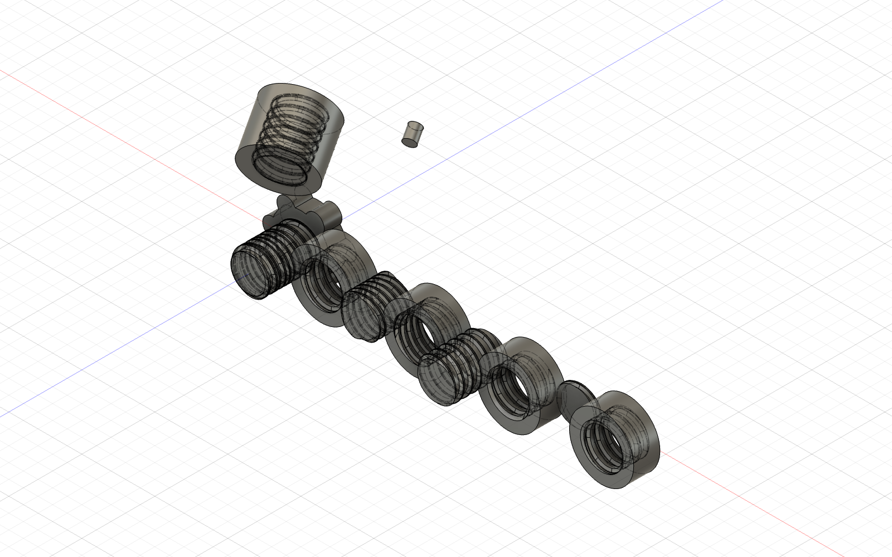

# Validation results

Validated in Autodesk Fusion 2704.1.53 on macOS 26.6.2 (Apple silicon).

## Automated model tests

`python3 -m unittest discover -s tests -v` passes 24 tests covering recipe validation, lead and turn calculations, balanced thread-size derivation, rounded-profile geometry, clearance derivation, handedness, serialization, presets, preview-mesh bounds, bounded fit samples, settings persistence with damaged-file recovery, circular section sizing, and legacy recipe preservation.

The default display mesh benchmarks at 0.32 ms per screw on the development Mac (1,000 iterations; 868 vertices and 1,700 triangles). The helix alone benchmarks at 0.11 ms. These are CPU mesh-construction times and exclude Fusion viewport refresh.

Real command previews were checked on 4 October 2026. Create, Apply, Edit, and Fit Test all passed preview toggle, thread-size change, unchanged timeline, and Cancel cleanup checks. Single observed updates, including Fusion graphics creation and viewport refresh, took 12.4 ms, 11.4 ms, 8.0 ms, and 10.3 ms respectively. These timings are measurements on small test documents, not guaranteed frame rates in large assemblies. Evidence is in [`preview-probe.json`](preview-probe.json).

## Fusion kernel probe

The `ThreadGeometryProbe` diagnostic passed in Fusion. Its machine-readable record is in [`probe-result.json`](probe-result.json), and the exported model is [`geometry-validation.f3d`](geometry-validation.f3d).

The shortened exact-sweep construction passed the full regression on 4 October 2026. Nominal male/female construction took 4.0 seconds, three-start 2.2 seconds, left-hand 4.2 seconds, and fractional-turn 2.0 seconds. The preceding fixed-overshoot run took 5.9, 3.9, 6.2, and 3.4 seconds respectively; the observed reduction was 33–43%.

- Nominal, three-start, left-hand and fractional-turn male/female cases all produced valid solids.
- Each case passed 12 section checks within 0.06 mm.
- Coordinated male/female positions had zero solid intersection at three tested phases for every case.
- Owned-body regeneration, lobed-knob solidity and the blind floor passed.
- External and internal Apply operations passed on rotated occurrences and left the neighboring body unchanged.
- Apply passed on a populated Part document: opening the command left the design intent unchanged, execution promoted it to Hybrid, and the selected body remained valid and received the thread.
- The regeneration guard rejected a component with downstream features.

## UI and installation

The add-in was copied into Fusion's per-user AddIns directory and started successfully. Fusion registered one **Printable Threads** dropdown as the final control in `SolidCreatePanel`; its four items are Create, Apply, Edit, and Fit Test. The Create dialog was opened in Fusion and the default matched pair completed in a new document.

The installed 0.2.0 build was checked again after the final update. A keyboard change to Thread size updated the derived outside diameter immediately. Clicking OK in a new Part document promoted it to Hybrid and created two valid solid components, with zero preview graphics remaining. See [`installed-smoke-test.json`](installed-smoke-test.json).

The installed 0.2.1 dialog was checked on 5 October 2026. The main tolerance input initially displayed 0.2 mm. A keyboard change to thread length was retained after Cancel and stopping/restarting the add-in. Settings are stored separately from the installation.

## Circular section update — 5 October 2026

The 0.3.0 build uses native sketch circles for nominal circular sections and native ellipses for female flank allowance. Four kernel cases (nominal, small, left-hand, three-start) passed 24 circular cross-section containment checks at 0.05 mm, valid male/female solids, and zero mating intersection. Observed pair construction took 0.69–1.38 seconds on these test documents. See [`circular-section-probe.json`](circular-section-probe.json).

The installed dialog displayed Section size 2 mm, Diameter 12 mm, tolerance 0.2 mm, and derived outside diameter 14 mm. Clicking OK produced two solid components and cleared preview graphics; circular owned-body regeneration also passed. See [`circular-installed-test.json`](circular-installed-test.json). These checks verify section size and placement; they do not claim whole-body identity with Coil’s untrimmed ends.

## Reversed cut/join update

Five kernel cases passed: cut screw/joined nut, left-hand, three-start, swapped legacy behavior, and reversed trapezoid. All mating thread intersections were empty. Volume checks confirmed the screw loses material and the nut gains material. Knob screws, nuts, and blind caps had minimum Z=0 in print placement. External Apply cut material and internal Apply joined material. See [`reversed-thread-probe.json`](reversed-thread-probe.json).

## Remaining physical check

No printed coupon has been measured yet. Printer, material, nozzle, layer height and slicer compensation can change the useful clearance. Print the Fit Test set and record the result in [`PRINT-CALIBRATION.md`](PRINT-CALIBRATION.md) before committing to a long print.

## Flush nut ends — 0.3.2

Removed nut entry taper, which cleared inward ribs near both end faces. Final nut geometry is clipped to its axial blank after booleans. Screw entry taper is retained. All 24 automated tests pass. A focused kernel check is provided in `diagnostics/flush_nut_probe.py`; it checks rib containment 0.005 mm inside both ends and exact axial bounds for default, fractional, left-hand, multistart and blind cases. The check has not yet run because Fusion’s main window was unavailable to UI automation.

## Partial and interrupted Apply — 0.4.0

Replaced the two-complete-circle selection gate with cylindrical boundary measurement. Joined tools intersect a temporary symmetric Thicken of the selected trimmed face; temporary native features are removed before commit. Cuts operate on the existing target. Python compilation and 24 automated tests pass. `diagnostics/interrupted_apply_probe.py` checks both cut/join modes on partial external and internal cylinders and tests that the removed half stays empty. Live kernel validation remains pending: UI automation repeatedly reported user changes without executing the console command, so no kernel result is claimed for this release.

## Apply selection transition — 0.4.1

Capture and freeze the selected target before preview cleanup or Part-to-Hybrid promotion. Resolve an invalidated entity by its token. Explicit deselection before execution discards the cached target. All 27 tests pass, including selection clearing during promotion, token resolution, and explicit deselection. This addresses the reported `SelectionCommandInput.selection(0)` invalid-index traceback; interrupted-face kernel validation remains pending.

## Applied solid regions — 0.4.2

Standalone fasteners still require one solid region. Apply permits cut results with multiple closed regions and preserves existing multiple regions in joined results. Joined results introducing disconnected regions and all empty/non-solid results are rejected with distinct messages. Region counts, solid state and volume are logged for diagnosis. All 31 tests pass; native interrupted-Apply validation remains pending.

## Visible build and source reload — 0.4.3

Every dialog displays the loaded version. Add-in startup executes dependency source files in order to bypass retained bytecode. The ReloadPrintableThreads diagnostic now refreshes the entrypoint and all dependencies rather than only the command module. Disk comparison confirmed the installed Apply source uses validate_applied rather than the single-region b.check call shown in the stale traceback. All 31 tests pass.

## Restore regular-cylinder Apply — 0.4.4

Removed the unsupported solid-face Thicken operation identified in the latest user traceback. Restored selection of full cylindrical faces with two circular end edges and the direct sweep/boolean/Combine path. Selection retention and applied-solid validation remain. All 31 unit tests pass and Python compilation succeeds. Current native validation was not run because the user’s export dialog was open; earlier reversed regular-cylinder Apply kernel evidence is in reversed-thread-probe.json.

## Timeline insertion — 0.4.5

Removed the global end-of-timeline gate from design access for Create, Apply, and Fit Test. Part-to-Hybrid promotion retains the current marker. Native feature creation uses the current insertion point. Owned-body Edit retains its independent downstream-feature guard. Python compilation and all 31 tests pass; native timeline insertion has not yet been verified in Fusion.
